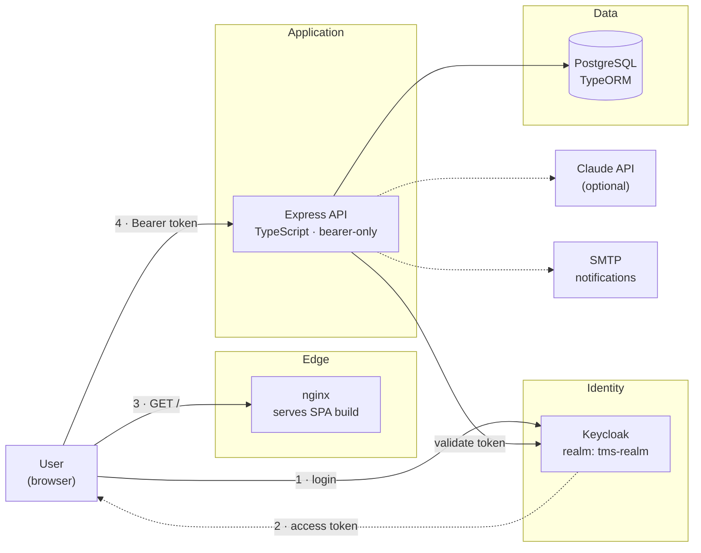
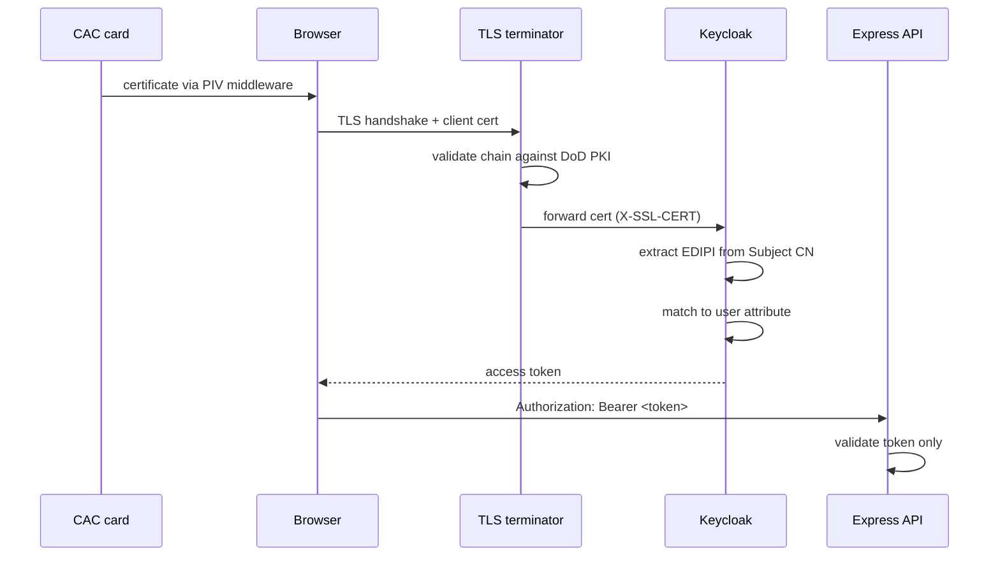
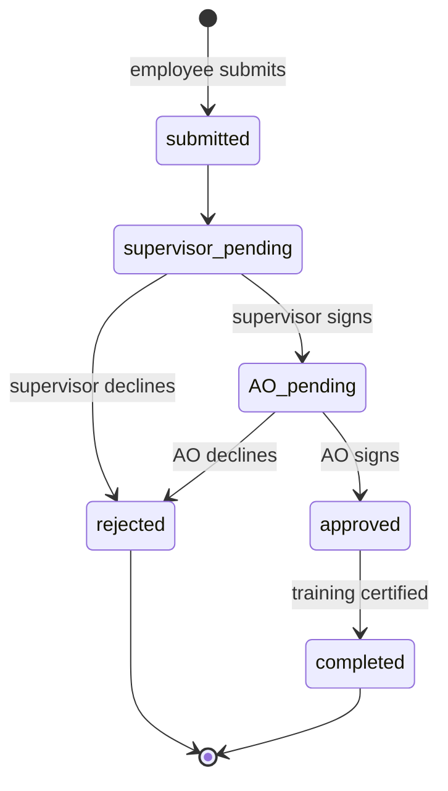
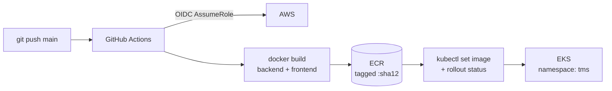

# Training Management System

A web application for the U.S. federal **SF-182** training request workflow — *Authorization, Agreement, and Certification of Training* — with Keycloak single sign-on, a two-stage approval chain, and a deployment path from `docker compose up` to EKS.

The SF-182 is a four-page OPM form with five code tables that most employees fill out wrong. This app models the real form field-for-field, routes it through the approvals it actually requires, and uses an LLM for the two steps people get stuck on — without ever letting the model write a value onto the form unchecked.

---

## Architecture



The frontend authenticates against Keycloak directly and sends the resulting access token as a `Bearer` header. **The API is a bearer-only resource server — it validates tokens and never handles credentials itself.** That single decision is what makes the auth story below work.

---

## Authentication, and why CAC needs no code changes

Keycloak fronts all authentication. The realm ships with **two** browser flows:

| Flow | Status | Used for |
|---|---|---|
| `browser` (default) | **active** | Username/password — local development and demos |
| `browser-cac` | configured, not bound | DoD **CAC/PIV** smart card via X.509 client certificate |



Switching from password to CAC is a **Keycloak binding change, not an application change.** The API trusts whichever identity Keycloak vouches for in the token; it has no opinion on whether that identity was established by a password or a certificate. Every approval already records `{approver, role, timestamp}` — so the moment `browser-cac` becomes the bound flow, those become genuine CAC-backed signatures with no code touched.

`browser-cac` is intentionally left unbound because activating it needs infrastructure a local Docker setup doesn't have: mutual TLS in front of Keycloak, the DoD CA trust chain, PIV reader middleware on each client, and an `EDIPI` attribute per user. Full walkthrough in [`keycloak/CAC-SETUP.md`](keycloak/CAC-SETUP.md).

On AWS, ALB supports mutual TLS directly in *verify* mode, forwarding the validated certificate as `X-Amzn-Mtls-Clientcert-*` headers — these need mapping to the nginx/haproxy/apache header names Keycloak's `X509ClientCertificateLookup` expects.

---

## Approval workflow

Four roles — `employee`, `supervisor`, `AO` (Authorizing Official), `HR` — gate every route through role-checking middleware.



Each stage writes its own signature column — `supervisorSignedAt`, `AOComments`, `AOSignedAt`, `approvedBy` — rather than overwriting a single status field, so the record keeps the full approval history. Completion certification (Section F) is a separate step restricted to `AO` and `HR`.

---

## The data model follows the real form

`TrainingRequest` maps the paper SF-182 section by section: Section B training course data with all five classification code tables, Section C costs split across tuition / books / travel / per diem with their appropriation funds, Sections D.1 and E.1 for the two signatures, Section F for completion.

Two deliberate choices:

- **SSN is not collected.** It is marked *Agency Use Only* on the real form and has no business living in a self-service web app. Omitted from both `User` and `TrainingRequest`.
- **Submitted values are copied, not referenced.** A request links back to the `Vendor`/`Course` catalog entry for traceability, but stores what was actually submitted in its own columns — so editing a catalog record later never silently rewrites an approved request.

---

## AI assists (optional)

Two narrow, human-in-the-loop assists over the form. Both return a **suggestion the employee reviews and edits** — neither ever writes a value directly into a request.

- **Draft the Skill/Learning Objective** (item 20) — turns the employee's rough notes into the 2–4 sentence justification the form wants.
- **Suggest classification codes** — the Purpose / Type / Sub-Type / Delivery / Source codes, which is the part of the real form people most often get wrong.

The model is given the actual OPM code tables and returns structured JSON, and **every returned code is then validated against those tables server-side and dropped if it doesn't match.** A plausible-looking invalid code never reaches the form.

If `ANTHROPIC_API_KEY` isn't set the feature returns `503` and the rest of the app runs normally — it does not block startup.

---

## Run it locally

```bash
docker compose up -d                  # PostgreSQL + Keycloak (auto-imports the realm)

cd backend
cp .env.example .env
npm install && npm run seed           # seed the catalog and test data
npm run dev

cd ../frontend
npm install && npm start
```

| Service | URL |
|---|---|
| Frontend | http://localhost:3000 |
| API | http://localhost:3001 |
| Keycloak admin | http://localhost:8080/admin |

Postgres is mapped to host port **55432** to avoid colliding with a local cluster on 5432.

The realm import seeds test users for each role. **These are local development fixtures with throwaway passwords — never point this realm file at a real Keycloak.** The `tms-realm` client secret in the dev export is likewise a placeholder; in production it comes from a Kubernetes Secret or AWS Secrets Manager via environment variable, never from a checked-in file.

`backend/.env.example` lists every variable the API reads, including the optional `ANTHROPIC_API_KEY`.

---

## Deploy to AWS



Terraform in [`infra/terraform/`](infra/terraform) provisions VPC, EKS, RDS, ECR, the AWS Load Balancer Controller, DNS, and the GitHub Actions IAM role. Kubernetes manifests live in [`infra/k8s/`](infra/k8s). Full runbook in [`docs/AWS-DEPLOYMENT.md`](docs/AWS-DEPLOYMENT.md).

Three things worth calling out in the pipeline:

- **No static AWS keys.** GitHub Actions assumes a role via OIDC (`id-token: write`), so there are no long-lived credentials in repository secrets.
- **Images are tagged with the commit SHA**, not just `latest`, so a rollout is traceable to a commit and `kubectl rollout undo` means something.
- **Database and client secrets are generated by Terraform** (`random_password`) and written to a secret store — no secret value exists in the repository. State is gitignored, since Terraform state holds those values in plaintext.

---

## Repo layout

```
backend/     Express + TypeScript API, TypeORM entities, Keycloak middleware
frontend/    React SPA, keycloak-js, multi-stage Docker build served by nginx
keycloak/    Realm export (roles, clients, browser-cac flow) + CAC setup guide
infra/k8s/   Kubernetes manifests
infra/       Terraform: VPC, EKS, RDS, ECR, ALB controller, DNS, CI IAM role
scripts/     Build and deploy helpers
docs/        AWS deployment runbook
```

---

## Notes on the build

**Why Keycloak instead of rolling auth into the app.** Hand-rolled JWT auth would have been faster to write and would have made CAC a rewrite. Putting an identity provider in front means the app supports password login locally and certificate login in a DoD environment through configuration alone. The cost is an extra service to run; the payoff is that the hardest requirement became a settings change.

**Why the LLM output is validated rather than trusted.** The classification codes are the most useful place to apply a model and the worst place to be confidently wrong — a bad code on an approved SF-182 is a real problem downstream. Constraining the response with a JSON schema and *then* re-checking every code against the source tables means a wrong answer degrades to a blank field instead of a plausible lie.

**What I'd do next.** Replace `kubectl set image` with a Helm chart so the deployment is one versioned artifact and rollback is `helm rollback`. Add Jest coverage on the approval state machine, which is where the real business logic lives. Move secrets to the External Secrets Operator so Kubernetes pulls from Secrets Manager instead of Terraform writing them in.
